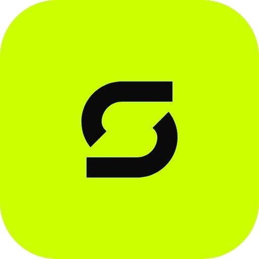

<p align="center">
  
</p>

<h1 align="center">StanClip</h1>

<p align="center">
  <strong>The Open-Source, Local-First AI Video Clipper & Social Automation Studio</strong>
</p>

<p align="center">
  Turn long-form videos and live broadcasts into viral 9:16 vertical shorts (YouTube Shorts, Instagram Reels, TikTok) with word-level animated subtitles, intelligent facecam detection, and automated publishing.
</p>

<p align="center">
  <a href="LICENSE"></a>
  
  
  
  
  
</p>

---

## Overview

**StanClip** is an open-source, privacy-focused desktop and server suite that transforms long video recordings into high-engagement vertical short clips.

Unlike proprietary SaaS tools that charge steep recurring subscriptions and upload your private audio to third-party clouds, StanClip executes **speech-to-text entirely on your local machine** using offline neural acoustic models.

Connect your preferred AI model—whether through a local model running on your computer via **Ollama**, or cloud providers like **Google Gemini**, **OpenAI**, **Claude**, **Grok**, or **Groq**—or run in **Zero-AI mode** using acoustic loudness detection.

---

## Key Features

### 🎙️ 100% Local Speech Recognition (Private & Free)
* Powered by `sherpa-onnx` and NeMo Parakeet 0.6B RNN-T.
* Generates millisecond-accurate word start/end timestamps on your CPU or GPU without sending audio data to external servers.

### 🧠 Intelligent Moment Scouting
* Evaluates transcripts against acoustic volume spikes `(LOUD)` and live audience chat surges `(CHAT)`.
* Generates hook headlines (<=5 bold uppercase words), SEO titles, descriptions, and hashtags.
* Built-in rule engine for **23+ mainstream games** (*GTA VI, Fortnite, Valorant, Minecraft, etc.*) that detects gameplay context and injects game tags.

### 🎨 10 Studio-Grade Caption Presets
Choose from 10 distinct typographic treatments rendered as SubStation Alpha (`.ass`) subtitles:
* **Bounce** *(Default)*: Dynamic bouncy text pop with bright yellow-green active word highlighting.
* **Hype**: Bold, condensed uppercase lettering using Anton font for high-intensity gaming and reaction clips.
* **Clean**: Minimalist, unobtrusive subtitle treatment with soft blue tracking.
* **Cinema**: Balanced, centered sentence-case lettering with subtle dark outlines for documentary and storytelling content.
* **Speaker Card**: Left-aligned sentence-case text inside a stabilized charcoal plate.
* **Marker**: Static sentence row with an animated lime highlighter pill behind the currently spoken word.
* **Word Build**: Progressive word reveal that preserves spacing without text shifting.
* **Pulse**: Center-anchored single-word burst designed for rapid-fire punchlines.
* **Sweep**: Smooth color sweep travelling across each word as it is spoken.
* **Focus Line**: Two-line lecture display with current dialogue in bold contrast and upcoming dialogue previewed quietly below.

### 📐 Smart Visual Layouts & Layout Studio
* **Gameplay + Facecam Split**: Computer vision algorithms detect static webcam borders and motion deltas, automatically framing streamer facecams above gameplay.
* **Podcast Active Speaker Tracking**: Employs OpenCV face cascades and Light-ASD audio-visual neural correlation to switch angles between speaking hosts.
* **Manual Layout Studio**: Drag-and-drop interactive 9:16 canvas builder for custom region positioning, circular masks, and border styling.
* **Blurred Fill & Zoomed**: Clean aspect ratio padding for horizontal talking-head videos.

### 🔴 Live Stream Clipping
* Monitors active **Twitch**, **Kick**, or **YouTube Live** streams in real-time.
* Stores a rolling circular chunk buffer and cuts clips while the broadcast is still live.

### 🚀 Autonomous Multi-Platform Publishing
* One-click scheduling and direct upload to **YouTube Shorts**, **Instagram Reels** (via secure media tunnel relays), and **TikTok**.
* Configurable post spacing intervals (e.g. 45 min) and daily post limits to protect channel reputation.

---

## Supported Platforms & Requirements

| Component | Minimum | Recommended |
| :--- | :--- | :--- |
| **Operating System** | Windows 10/11 (64-bit), Ubuntu 20.04+, macOS 12+ | Windows 11 or Linux Ubuntu 22.04 LTS |
| **Processor** | 4-Core x86_64 CPU | 8+ Core CPU or NVIDIA RTX GPU |
| **RAM** | 8 GB | 16 GB+ |
| **Disk Space** | 10 GB free space | Fast NVMe SSD |
| **Prerequisites** | Python 3.10+, FFmpeg | FFmpeg 6.0+, Ollama |

---

## Quick Start (Windows)

1. **Install FFmpeg** (if not already installed):
   ```powershell
   winget install Gyan.FFmpeg
   ```
2. **Clone the repository** into a short folder (e.g. `C:\StanClip` or `D:\StanClip`):
   ```cmd
   git clone https://github.com/eswarmadapani/StanClips.git C:\StanClip
   cd C:\StanClip
   ```
3. **Run the automated setup**:
   ```cmd
   scripts\setup.bat
   ```
4. **Launch StanClip**:
   ```cmd
   scripts\start.bat
   ```
5. Open **`http://127.0.0.1:8765`** in your browser.

---

## Quick Start (Linux / macOS)

1. **Install FFmpeg**:
   ```bash
   # Ubuntu / Debian
   sudo apt update && sudo apt install -y ffmpeg

   # macOS
   brew install ffmpeg
   ```
2. **Clone and setup**:
   ```bash
   git clone https://github.com/eswarmadapani/StanClips.git ~/StanClip
   cd ~/StanClip
   chmod +x scripts/*.sh
   ./scripts/setup.sh
   ```
3. **Launch StanClip**:
   ```bash
   ./scripts/start.sh
   ```

---

## Local AI Configuration (Ollama)

For completely private, zero-cost AI clip scouting:

1. Download and run [Ollama](https://ollama.com).
2. Pull a model:
   ```bash
   ollama pull llama3.1
   ```
3. In StanClip, navigate to **Settings > AI**, select **Ollama (on this machine)**, click **Find models**, and select your installed model.

---

## Architecture

```
[ Video / Live Stream ] ──► [ Local Parakeet ASR ] ──► [ AI Scout (Ollama/Gemini/GPT) ]
                                                                   │
                                                                   ▼
[ Final 9:16 Clip ] ◄── [ FFmpeg Compositor ] ◄── [ 10 Caption Presets + Smart Layout ]
         │
         └──► [ Fair Post Queue: YouTube Shorts / Instagram Reels / TikTok ]
```

---

## Documentation

* [Installation Guide](docs/installation.md) — Comprehensive setup instructions for all platforms.
* [Configuration Guide](docs/configuration.md) — Detailed environment variables and settings.
* [System Architecture](docs/architecture.md) — Deep dive into pipelines, ASR, and renderers.
* [Local AI with Ollama](docs/local-ai.md) — Hardware recommendations and local model guide.
* [Social Integrations](docs/social-integrations.md) — YouTube, Instagram, and TikTok developer setup.
* [Troubleshooting](docs/troubleshooting.md) — Solutions to common issues.
* [Developer Guide](docs/development.md) — Contributing, frontend building, and testing.

---

## Responsible Use

StanClip is a productivity tool for video creators, editors, and archivists. Users are solely responsible for ensuring they possess the necessary rights, licenses, or permissions to download, process, edit, and publish any source media. Always respect platform terms of service and original creator intellectual property.

---

## License & Acknowledgments

This project is licensed under the **[MIT License](LICENSE)**.

> **Upstream Heritage & Attribution**  
> StanClips is built upon the open-source [PeakCut](https://github.com/haziqahmedqasmi/peakcut) project and extends it with a customized modern interface, drag-and-drop Layout Studio, 10 advanced caption presets, and enhanced creator workflows.
> 
> We acknowledge and thank the original PeakCut developers and contributors for their foundational work.  
> Original repository: [https://github.com/haziqahmedqasmi/peakcut](https://github.com/haziqahmedqasmi/peakcut)

* Active Speaker Detection adapted from [Light-ASD](https://github.com/Junhua-Liao/Light-ASD) (MIT License).
* Bundled typography fonts (*Poppins, Anton, Archivo Black*) are licensed under the [SIL Open Font License 1.1](studio/fonts/).
* Offline speech recognition utilizes the NeMo Parakeet model under [CC-BY-4.0](https://creativecommons.org/licenses/by/4.0/).

See [NOTICE](NOTICE) for complete third-party dependency acknowledgments.
